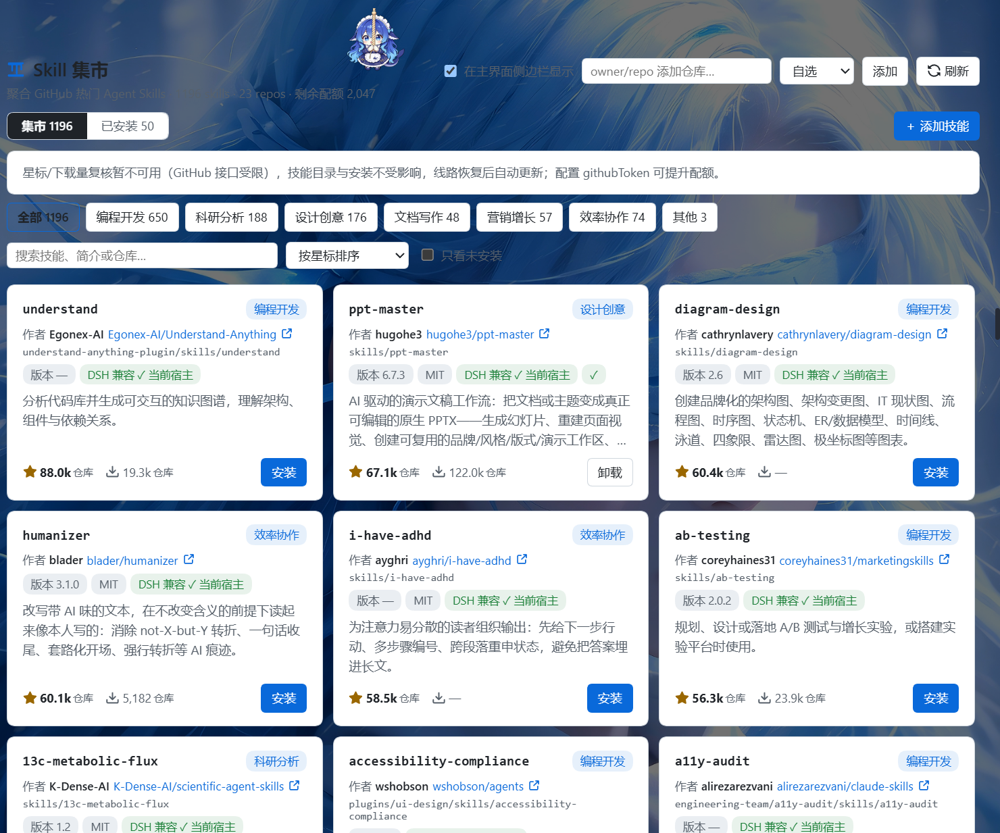
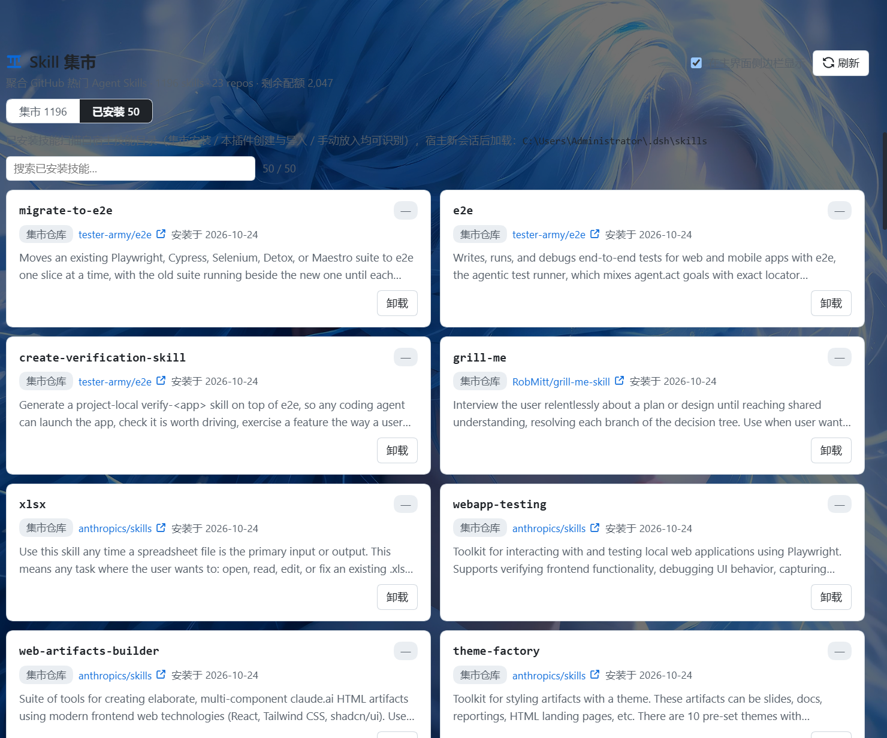

# Skill 集市（ds-skillmarket）

DeepSeek Harness（DSH）插件：把 GitHub 上符合规范的 Agent Skills 聚合成一个集市界面——开箱即用的内置精选目录（23 个仓库 / 1196 个技能），星标、下载量一目了然；卡片一键安装，安装全程进度可视化；支持查看/卸载已装技能、本地新建与 URL 导入。

**v1.0.1** · 纯 JavaScript · 零构建 · 零运行时依赖（仅 Node 内置模块 + 全局 fetch）· 中英双语 · 深浅色主题

| 集市 | 已安装 | 安装进度 |
|---|---|---|
|  |  |  |

## 功能

### 集市

- **秒开快照**：内置精选目录快照（23 仓库 / 1196 技能，含中文名简介），打开零网络首屏即渲染全部卡片。
- **技能卡片**：名称（GitHub 目录名）、场景分类、作者 + 来源仓库直达链接、版本、许可证、DSH 兼容标识、仓库级星标/下载量（含口径说明与抓取日期）、能力简介、安装/卸载按钮。
- **场景分类**：编程开发 / 科研分析 / 设计创意 / 文档写作 / 营销增长 / 效率协作 / 其他（确定性中英文关键词规则 + 仓库先验），分类条带计数。
- **搜索与排序**：关键词搜索（技能名、GitHub 目录名、仓库内路径、简介、仓库）；按星标 / 下载量 / 更新时间 / 名称排序；「只看未安装」；超过 120 张「显示更多」分页。
- **仓库轮转交错**：星标/作者是仓库级口径，相邻卡片自动打散来自不同仓库，首屏可见多组数据。
- **自选仓库**：输入 `owner/repo` 添加（可指定分类），详情经 tarball 解析渐进拉取（3 路并发）。

### 安装（v1.0 任务化进度）

- 卡片「安装」立即进入进度模式：**下载中**显示动画条 + 已下载字节 + 实时速率（指数滑动平均估算）；**解包中**动画条；**安装中**显示 `skillDone/skillTotal` 确定条与当前技能名。
- 完成：卡片自动翻成「卸载」+「已安装」提示（含跳过数）；失败：退回安装按钮，失败原因按类型本地化展示，点击即重试。
- 同仓库并发智能合并：安装进行中再点同仓库另一技能，自动并入同一次下载（不重复下载）；解包/安装阶段的新提交自动排队，借 tarball 缓存秒装；导入与安装共用单仓库单飞。
- **同名保护**：同名技能来自其他来源（异仓 / 手动放入 / URL 导入）时跳过不覆盖，集市安装与 URL 导入同一规则。
- 进度状态跨视图存活：翻页、切换集市↔已安装视图不丢；下载/安装中可一键取消任务。
- 卸载两步确认；安装位置 `~/.dsh/skills/<技能名>/`（目录名 = SKILL.md frontmatter `name`，符合 DSH skills 规范），宿主新会话后加载。

### 已安装视图

- 列出 `~/.dsh/skills` 全部技能：名称、版本、来源徽章（集市仓库 / URL 导入 / 本插件创建 / 手动放入）+ 来源链接、安装日期、简介；独立搜索框；两步确认卸载。
- **既有技能识别（v1.0.1）**：插件启动即读取你在此前放入宿主技能目录的全部技能（手动拷贝、其他工具安装的均可识别），回填安装记录并显示安装日期；集市里同名卡片自动同步已安装状态；若集市目录存在同名条目，还会给出"集市同名"来源线索（按名称推断、仅供参考）。识别只补元数据，绝不改动技能文件，集市下载也不会覆盖你手动放入的同名技能。

### 添加技能

- **本地新建**：技能名 + 一句话简介（+ 可选正文）→ 生成规范 SKILL.md 落盘。
- **URL 导入**：粘贴 GitHub 链接即可——Clone 链接（含 `.git`）整仓导入（**完整检索全部文件，含 `.agents/skills` 等隐藏目录中的技能**，仅排除 `node_modules`）、`tree/分支/目录` 深链只装该目录、blob 页 SKILL.md 链接自动转 raw、raw/gist 直链单文件；同样任务化进度、可取消；同名技能同源覆盖更新、异源跳过；超限（128MB tarball）流式掐断并提示改用深链；链接无技能 / 格式不受支持 / 目录下无技能等失败场景按类型给出本地化原因与建议。

### 多线路加速与零配额刷新（中国大陆实测驱动）

- **线路表按服务分链**：api/code 走「自定义前缀 → gh-proxy.com → ghfast.top → 直连兜底」，git 广播直连优先；自定义前缀置顶而非替换，直连兜底永不丢；按服务记忆最后成功线路并持久化（重启不重探）。
- **零配额刷新**：仓库 HEAD 用 git 智能协议广播获取（完全不占 GitHub API 配额）；HEAD 未变且星标未过 12h 则 0 次 REST；星标/下载量等少量 REST 经加速线路的公共账号池，不受本机匿名 60 次/小时限制。
- **降级不故障**：REST 全线失败时保留旧数据、30 分钟重试冷却，界面以中性说明标注；gzip 魔数校验拒绝代理错误页伪装。
- **下载区域偏好**：china（加速优先）/ global（直连优先），切换即生效并持久化。

### 设置

设置 → 内置插件 页签中的设置卡片：打开集市、侧边栏入口开关、下载区域（china/global）、GitHub 加速线路展示与自定义前缀（operator 配置可锁定）、GitHub Token 说明、本地缓存统计与两步清理、数据目录。

## 安装

### dsh web

```sh
dsh plugin --profile web add ds-skillmarket
```

（发布 npm 后可用；从源码安装见下。）

### DSH Desktop

`desktop` profile 归 Electron 应用独占：在应用内 **设置 → 插件** 安装，不要对 desktop profile 使用命令行。

### 从源码安装（本地开发）

```sh
# web profile
dsh plugin --profile web add "link:/path/to/ds-skillmarket"

# 或手动：profile 的 package.json 加 "ds-skillmarket": "link:<绝对路径>"
# 并把 "ds-skillmarket" 追加进 dsh.profile.bundles，然后 pnpm install
```

安装后重启宿主。三个入口：设置侧边栏「Skill 集市」分区（集市本体）、设置 → 内置插件页签（设置卡片）、主界面侧边栏行（开关默认关，在设置卡片打开）。

## 配置（可选）

写进 profile 的 `cordis.patch.yml`（必须嵌在该插件的 `config:` 下，写在顶层会静默失效）：

```yaml
- id: skill-market
  name: 'ds-skillmarket'
  config:
    githubToken: ghp_xxx        # GitHub PAT：星标复核更稳；携带凭据的请求绝不经过加速前缀
    downloadProxy: https://gh-proxy.com  # 下载/API 加速前缀（operator 级，配置后界面输入锁定）
    ttlMinutes: 360             # 统计缓存有效期（分钟），默认 360
    skillsHome: ~/.dsh/skills   # 技能安装目录，一般不用改
```

环境变量等价：`DSH_SKILL_MARKET_TOKEN` / `DSH_SKILL_MARKET_PROXY`（或 `GITHUB_TOKEN`）。

申请 Token：GitHub → Settings → Developer settings → Personal access tokens，**无需勾选任何权限**（只读公开数据，纯提额）。

## 数据口径

- **星标数** = `stargazers_count`（仓库级实时值）；**下载量** = 该仓库全部 Release 资产 `download_count` 累计——GitHub 不公开目录级/clone 统计，只发源码不打包资产的仓库显示 `—`。
- 卡片「N 个技能」来自 tarball/git tree 扫描：仓库内任意深度、以 `SKILL.md` 结尾且路径不含隐藏目录与 `node_modules` 的目录各算一个技能。
- 作者优先取 SKILL.md 声明，缺省为仓库 owner；版本取 frontmatter `metadata.version`。
- 每次安装/创建/导入记入台账 `~/.dsh/skill-market/installed.json`。

## 安全

- 出站请求仅 http/https，逐跳校验 host：拒绝 localhost、环回、私有与保留地址（含 DNS 解析复核），防 SSRF；固定 GitHub 文本 host 白名单例外。
- tar 解包有大小（512 MB）与条目数上限；拒绝绝对路径、盘符与父目录引用；所有落盘路径经规范化 + 目录包含校验（safeJoin）。
- 只安装目录（内置精选 + 用户自选）内的来源；仓库引用有白名单格式校验。
- 卸载仅作用于 skills 目录下确实含 `SKILL.md` 的具名目录。
- 不向任何第三方上报数据；Token 只发送给 `api.github.com`，绝不经过加速前缀。

## 架构

双面 Cordis 插件（与 dsh-market 同构）：

- **node half（`lib/index.js`）**：`export const name = 'skill-market'` + `apply(ctx, config)`；`ctx.inject(['webServer'])` 后经 `webServer.register` 挂同源 JSON API；全部副作用经 effect 登记可撤销；内置快照打底、多线路路由、任务化导入/安装、tarball 缓存、安装台账。
- **browser half（`lib/client.js`）**：`window.__ModuleLoader__.load({ id, factory })` 信封；`inject = ['slots', 'locale', 'theme']`；渲染只用 `React.createElement` + 内联样式 + 内联 SVG，零外部资源。
- `package.json` 的 `dsh` 字段声明插件身份（bundle patch / client platform）；`cordis.patch.yml` 顶层 `- insert: [{id: skill-market, name: 'ds-skillmarket'}]`。

## 开发

```sh
node --check lib/index.js
node --check lib/client.js
```

无构建链：源码即装机目录（pnpm link），改完语法检查、重启宿主即生效。语义化版本。运行时数据（缓存/台账/偏好）在 `~/.dsh/skill-market/`，与插件目录无关。

## 许可

MIT。技能内容版权归各自仓库作者；收录 ≠ 背书，请只安装你信任的来源。
